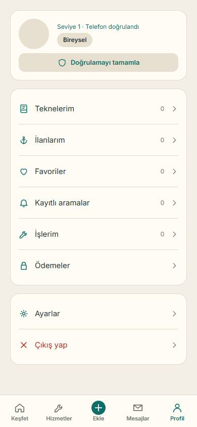
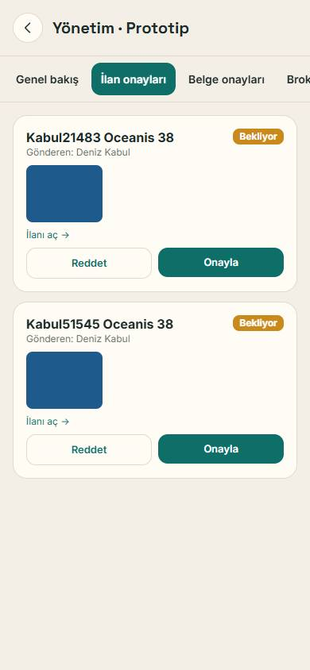
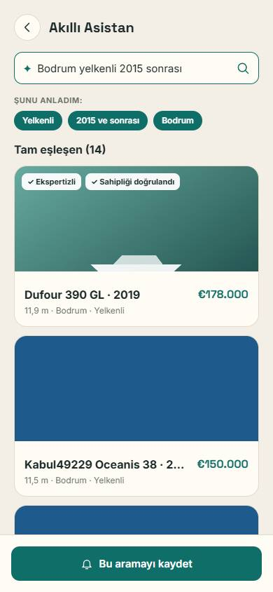
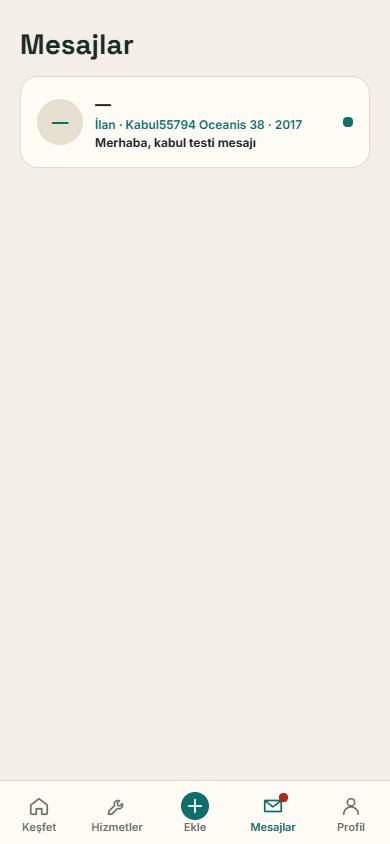
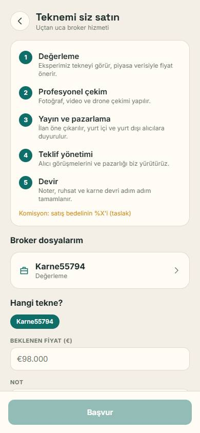

# Kapalı beta kabul testi

Çalıştırma: 2026-09-26 17:56 · Betik: `mobile/scripts/beta-acceptance.mjs` · Gerçek sunucu (npm run dev) · Chrome 390×844

## ✓ 1. Telefonla giriş (kod SMS yerine uygulamaya gelir) — geçti

Satıcı numarasıyla kod istenir, kod ekranda dolar, Doğrula ile oturum açılır.

## ✓ 2. Kimlik → fotoğraflı ilan → yönetici onayı → Keşfet — geçti

Satıcı T.C. kimliğini doğrular, gerçek fotoğraf yükleyerek ilan verir; yönetici onaylar; ilan herkese açık aramada çıkar.

## ◐ 3. Akıllı Asistan (Claude ve yedeği) — kısmi

Asistana metin yazılır, sonuçlar veritabanından gelir. Claude anahtarı yoksa kural tabanlı yedek devrededir.

**Not:** Claude API anahtarı tanımlı değil; kural tabanlı yedek devrede ve doğru sonuç verdi. Claude ile yanıt, anahtar eklenince denenecek.

## ✓ 4. İki hesap mesajlaşır; yeniden açınca veriler yerinde — geçti

Alıcı ilandan satıcıya mesaj atar; satıcı yeniden yükleyip girince mesajı görür.

## ✓ 5. Karne, favori, kayıtlı arama, ekspertiz ve broker kalıcı — geçti

Alıcı tekne ekler, ilanı favoriler, arama kaydeder, ekspertiz randevusu ve broker başvurusu yapar; sayfa yenilenip tekrar girince hepsi yerinde.

