# Demo akışları — doğrulama sonucu

Çalıştırma: 2026-09-26 11:15 · Betik: `mobile/scripts/demo-flows.mjs` · Tarayıcı: Chrome (390×844)

**Sonuç: 11/11 akış geçti.**

## ✓ 11. Misafir kimlik kapısını atlayamaz (inceleme bulgusu)

Giriş yapmamış kullanıcı Değerleme → "Ücretsiz ilan ver" ile sihirbaza gitmeye çalışır; önce giriş ekranına yönlenir.

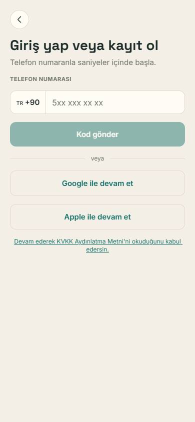

## ✓ 1. Asistanla arama → ilan → mesaj

Keşfet'te asistana sorgu yazılır, 3 tam eşleşme görülür, ilan açılır, satıcıya mesaj atılır ve otomatik yanıt gelir.

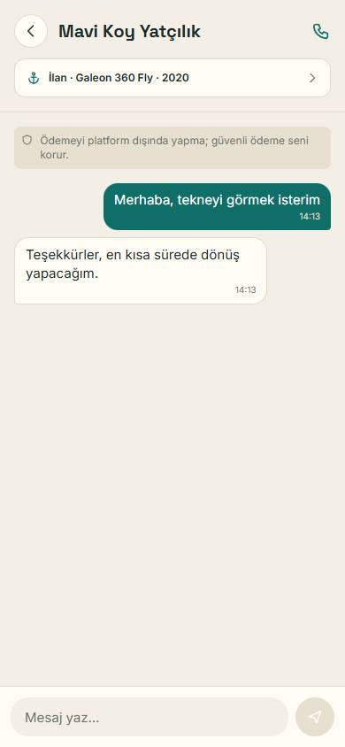

## ✓ 2. Sonuçsuz aramayı talebe çevirme

Eşleşmesi olmayan bir sorgu aranır, "Bu aramayı kaydet" ile kaydedilir ve kayıtlı aramalarda görünür.

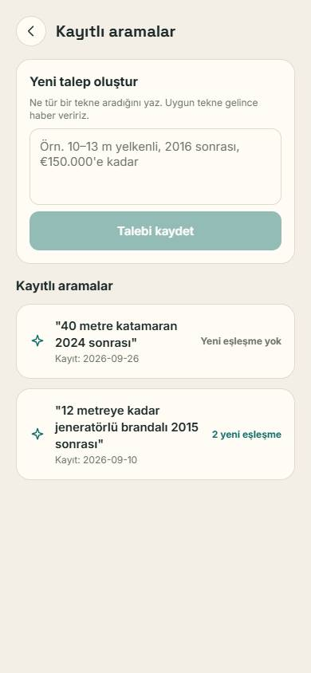

## ✓ 3. İlan verme (kimlik doğrulama dahil)

Ekle → İlan ver; kimlik doğrulanır, 5 adımlı sihirbaz doldurulur, önizleme sonrası yayınlanır, "Onay bekliyor" olarak görünür.

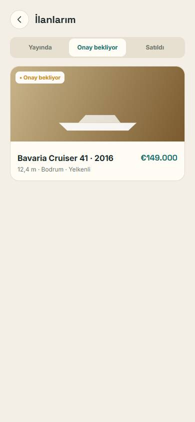

## ✓ 4. Usta işi → güvenli ödeme → karne

Hizmetler'de dert yazılır, talep açılır, 3 teklif karşılaştırılıp biri kabul edilir, güvenli ödeme yapılır, iş onaylanır, değerlendirilir ve karneye düşer.

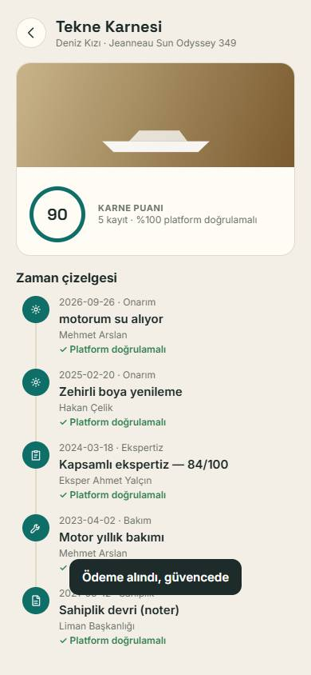

## ✓ 5. Haftalık kaptan kiralama

Kaptan ekranında haftalık seçilir, kaptan profili (belgeler) incelenir, rezervasyon yapılıp ödenir.

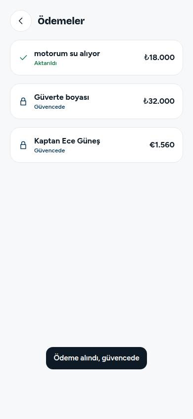

## ✓ 6. İlandan ekspertiz randevusu

İlan detayında "Ekspertiz iste" ile paket ve tarih seçilir, randevu alınır, örnek rapor açılır.

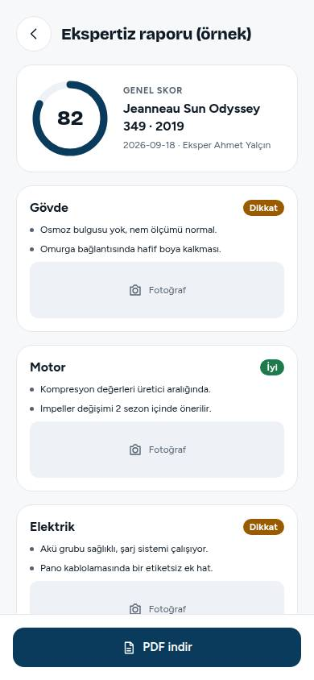

## ✓ 7. Broker başvurusu

Hizmetler → Broker; tekne seçilip beklenen fiyat girilir, başvurulur, süreç takip ekranı görünür.

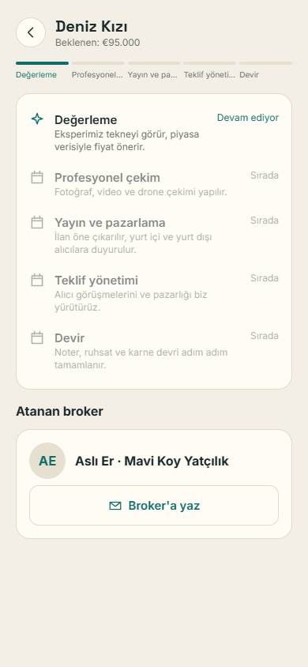

## ✓ 8. Değerleme

Keşfet → "Teknem kaç eder?"; tip, yıl, boy ile hesaplanır, fiyat aralığı ve benzer ilanlar görünür.

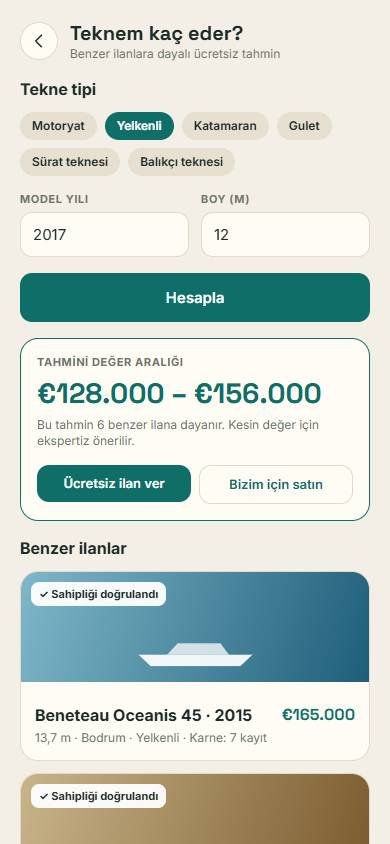

## ✓ 9. Roller ve yönetim onayı

Demo rol değiştirici ile usta, kurumsal ve yönetici panelleri açılır; yönetim panelinde akış 3'teki ilan onaylanır ve Keşfet'te yayında görünür.

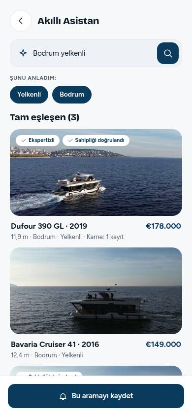

## ✓ 10. Dil: İngilizce

Ayarlar'dan English seçilir; sekmeler ve ekranlar İngilizce görünür.

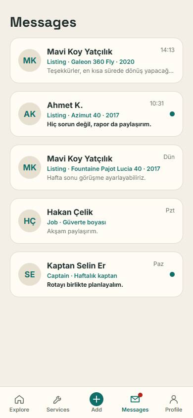
