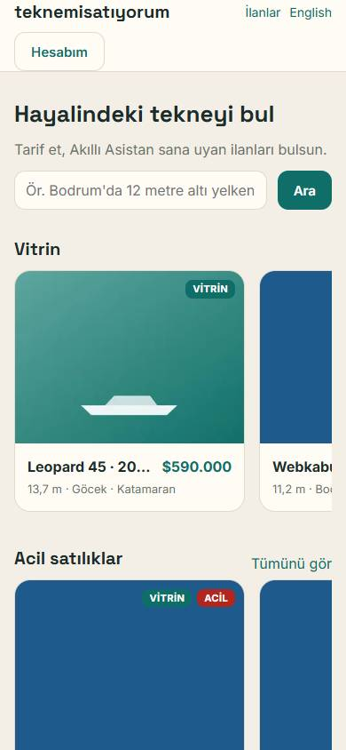
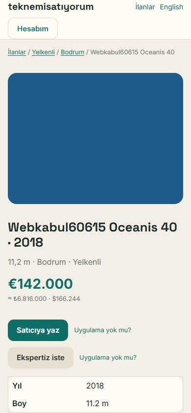
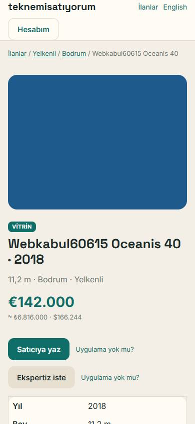

# Web vitrini kabul testi

Çalıştırma: 2026-09-27 10:07 · Betik: `web/scripts/web-acceptance.mjs` · Gerçek sunucu · Chrome 390×844

## ✓ 1. Site iki dilde açılır; tüm sayfa türleri gerçek veriyle çalışır — geçti

Ana sayfa (TR/EN), arama, hazır arama, ilan detayı, ekspertiz, usta-ol, KVKK sayfaları 200 döner ve başlıkları dolu.

## ✓ 2. İlan sayfası Google için hazır; site haritası güncel; kalkan ilan 410 — geçti

İlan başlığı kalıba uyar, paylaşım görseli ve schema.org Product var; site haritası yeni ilanı içerir; kaldırılan ilan 410 döner ve haritada yoktur.

## ✓ 3. Satıcı siteye girer, Vitrin 7 günü deneme ödemesiyle alır; sitede ve uygulamada etiketli — geçti

Tarayıcıda /giris → kod → Hesabım/İlanlarım → Öne çıkar → Vitrin · 7 gün → deneme ödemesi → sonuç; ilan sayfasında "Vitrin" etiketi; uygulamanın vitrin şeridi (GET /listings/showcase) ilanı içerir.

## ✓ 4. Uygulamadan Acil 7 gün (deneme mağaza ödemesi); sitede Acil etiketi — geçti

Uygulamanın kullandığı uç (POST /orders/store, deneme makbuzu) ile Acil · 7 gün alınır; ilan sitede "Acil" etiketiyle görünür.

## ✓ 5. Yönetici havale siparişi oluşturur, iade eder, fiyat değiştirir; hepsi kayıtta — geçti

Yönetim uçları (uygulamanın Siparişler/Fiyatlar ekranlarının çağırdığı): havale siparişi (açıklamalı), iade, vitrin_7 site fiyatı; işlem kaydında üç kayıt.

## ✓ 6. Sahte ödeme bildirimi ve tekrar kullanılan makbuz reddedilir — geçti

İmzasız POST /payments/web/callback → 400; aynı deneme makbuzu ikinci kez → 409 RECEIPT_USED.

## Hız ölçümü (Lighthouse, mobil, üretim derlemesi)

| Sayfa | Performans | Erişilebilirlik | SEO |
|---|---|---|---|
| Ana sayfa | 96 | 96 | 100 |
| İlan detayı | 92 | 96 | 100 |

Raporlar: `web-shots/lh-home.json`, `web-shots/lh-listing.json`. Ölçüm bu bilgisayarda (bellek az) yapıldı; canlı sunucuda yeniden ölçülmeli.
